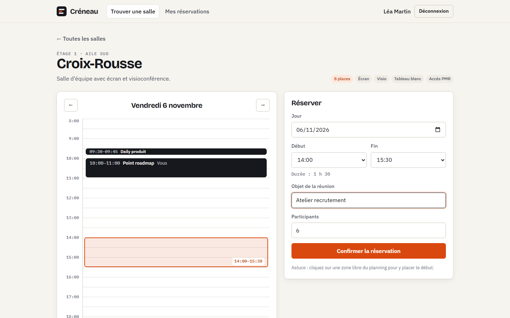
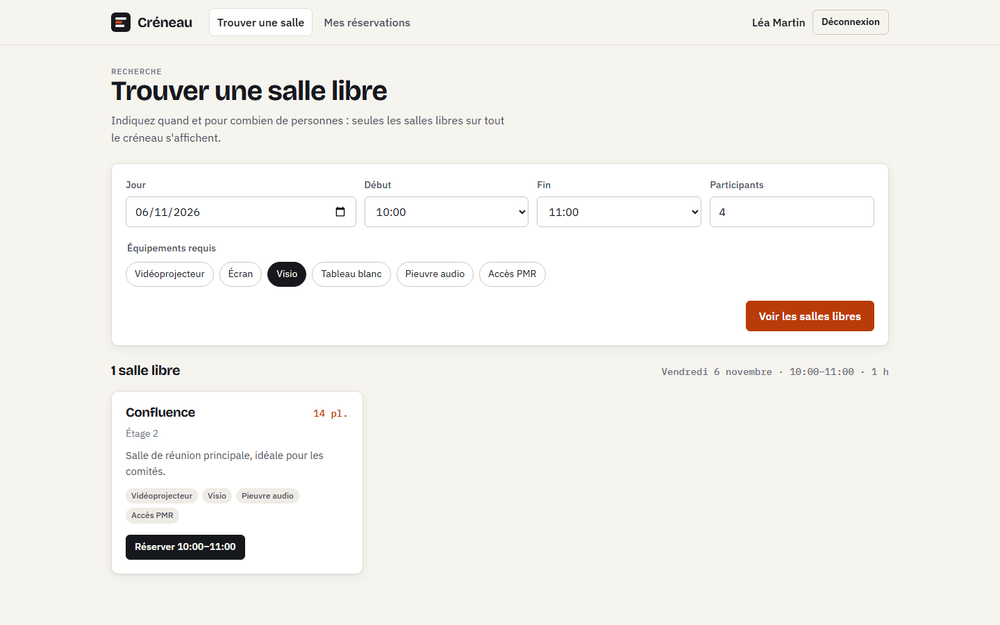
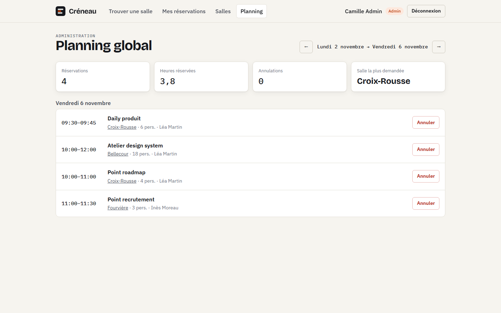
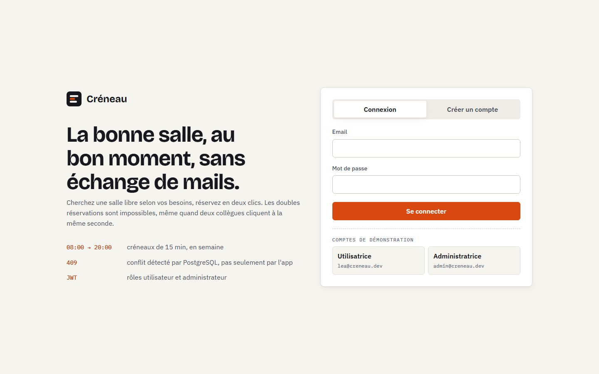
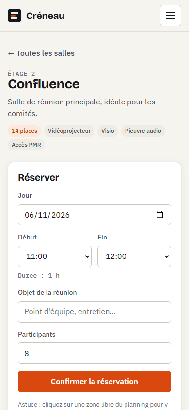

# Créneau

Application web de réservation de salles de réunion : on cherche une salle libre selon l'horaire, le nombre de participants et l'équipement, puis on la réserve en deux clics. Les administrateurs gèrent le parc de salles et voient le planning global.

**Stack** : Java 21 · Spring Boot 4.1 (Web MVC, Data JPA, Security, OAuth2 Resource Server, Validation, Actuator) · PostgreSQL 17 · Flyway · Angular 21 (standalone, signals, zoneless) · Testcontainers · Docker.



| Recherche de salles libres | Planning global (admin) |
| --- | --- |
|  |  |

| Connexion | Mobile |
| --- | --- |
|  |  |

```
creneau/
├── backend/            API REST Spring Boot
├── frontend/           SPA Angular
└── docker-compose.yml  stack complète (PostgreSQL + API + nginx)
```

## Fonctionnalités

- **Recherche de disponibilités** : salles libres sur toute une plage horaire, filtrées par capacité et équipements.
- **Planning du jour** par salle, avec les créneaux occupés. Un clic sur une zone libre place le début de la réunion.
- **Réservation** avec des règles métier explicites :
  - créneaux de 15 min, entre 8 h et 20 h, du lundi au vendredi ;
  - durée de 15 min à 4 h, jusqu'à 60 jours à l'avance ;
  - nombre de participants limité à la capacité de la salle.
- **Annulation** par l'organisateur ou un administrateur, jusqu'au début de la réunion.
- **Administration** : création, modification et archivage des salles. Une salle archivée garde son historique. Planning hebdomadaire de toutes les réservations, avec quelques indicateurs.
- **Authentification** par JWT signé, avec les rôles `USER` et `ADMIN`. Inscription libre en tant que `USER`.

## Choix techniques

**Aucune double réservation, même sous concurrence.** Le service vérifie d'abord les chevauchements pour renvoyer un message clair. Cette vérification ne suffit pas quand deux requêtes arrivent en même temps : la garantie vient d'une contrainte d'exclusion PostgreSQL ([`V1__schema.sql`](backend/src/main/resources/db/migration/V1__schema.sql)).

```sql
EXCLUDE USING gist (room_id WITH =, tstzrange(starts_at, ends_at, '[)') WITH &&)
WHERE (status = 'CONFIRMED')
```

Un test lance 8 réservations simultanées du même créneau et vérifie qu'exactement une passe. Les 7 autres reçoivent un `409 SLOT_TAKEN`.

**Règles métier isolées.** [`BookingPolicy`](backend/src/main/java/dev/axeldoussoux/creneau/booking/BookingPolicy.java) ne touche pas la base et reçoit une `Clock` injectée. Elle se teste unitairement avec une horloge fixe. Les règles sont configurables dans `application.yml`. Le front les lit via `GET /api/booking-rules`, ce qui évite de dupliquer les horaires.

**Erreurs normalisées.** Toutes les erreurs suivent la RFC 9457 (`ProblemDetail`) avec un `code` stable, par exemple `SLOT_TAKEN` ou `OUTSIDE_OPENING_HOURS` :
- `400` : validation, avec le détail par champ ;
- `401` / `403` : authentification et droits ;
- `409` : conflit ;
- `422` : règle métier non respectée.

**Fuseau horaire maîtrisé.**
- L'API échange des instants UTC.
- Les règles (heures d'ouverture, jours ouvrés) s'évaluent à l'heure de Paris.
- Le front convertit lui-même « jour + heure à Paris » en instant, sans dépendance externe. Il gère les changements d'heure, et c'est testé.

**API sans état.**
- Jeton HS256 émis par l'API et vérifié par le resource server de Spring Security, ce qui rend le CSRF sans objet.
- Le front envoie le jeton via un intercepteur et redirige vers la connexion sur `401`.

## Lancer le projet

### Tout en Docker

```bash
docker compose up --build
```

- Application : http://localhost:8088
- Swagger UI : http://localhost:8080/swagger-ui.html

### En développement

Prérequis : JDK 21, Node 24 (≥ 24.0) et Docker pour PostgreSQL.

```bash
cd backend
./mvnw spring-boot:run      # démarre aussi PostgreSQL via compose.yaml
```

```bash
cd frontend
npm install
npm start                   # http://localhost:4200, /api est relayé vers :8080
```

### Comptes de démonstration

Au premier démarrage sur une base vide, l'API crée six salles, quelques réservations sur les prochains jours ouvrés et ces comptes :

| Rôle | Email | Mot de passe |
| --- | --- | --- |
| Administrateur | `admin@creneau.dev` | `admin1234` |
| Utilisateur | `lea@creneau.dev` | `demo1234` |
| Utilisateur | `hugo@creneau.dev` | `demo1234` |

Ces données se désactivent avec `app.demo-data=false`. En production, fournir aussi `JWT_SECRET`, une clé base64 d'au moins 256 bits (`openssl rand -base64 32`).

## Tests

```bash
cd backend && ./mvnw test        # Docker requis (Testcontainers)
cd frontend && npm test -- --watch=false
```

- **`BookingPolicyTest`** : toutes les règles de réservation, avec une horloge fixe.
- **`BookingApiTests`** : l'API de bout en bout sur un vrai PostgreSQL. Couvre la sécurité par rôle, la recherche de disponibilités, les conflits, les erreurs normalisées, les droits d'annulation et la concurrence.
- **`time.spec.ts`** : les conversions de fuseau horaire du front, heure d'été comprise.

## API

| Méthode | Route | Rôle |
| --- | --- | --- |
| `POST` | `/api/auth/login`, `/api/auth/register` | public |
| `GET` | `/api/me`, `/api/booking-rules` | connecté |
| `GET` | `/api/rooms?capacity=&equipment=&from=&to=` | connecté |
| `GET` | `/api/rooms/{id}`, `/api/rooms/{id}/schedule?date=` | connecté |
| `GET` | `/api/bookings/mine?past=` | connecté |
| `POST` | `/api/bookings`, `/api/bookings/{id}/cancel` | connecté |
| `GET` `POST` `PUT` | `/api/admin/rooms`, `/api/admin/rooms/{id}` | admin |
| `PATCH` | `/api/admin/rooms/{id}/active` | admin |
| `GET` | `/api/admin/bookings?from=&to=` | admin |

La documentation interactive complète est servie par Swagger UI.
