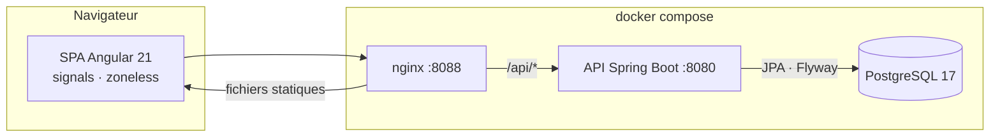
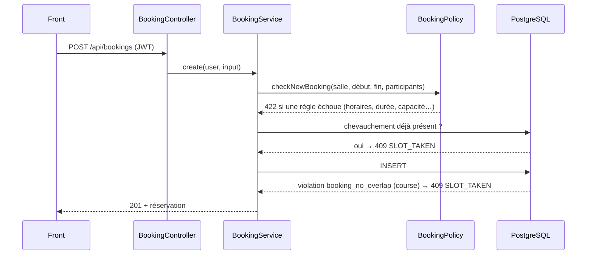

# Architecture

## Vue d'ensemble



- **nginx** sert la SPA et relaie `/api/` vers l'API : front et API partagent la même origine, donc pas de CORS en production.
- **L'API** est sans état. Elle émet un JWT HS256 à la connexion, puis le vérifie à chaque requête via le resource server de Spring Security.
- **PostgreSQL** porte la garantie finale contre les doubles réservations.

## Backend

Le code est découpé par domaine, pas par couche technique :

| Paquet | Rôle |
| --- | --- |
| `auth` | connexion, inscription, émission du jeton (`TokenService`) |
| `user` | entité `AppUser` et rôles `USER` / `ADMIN` |
| `room` | salles, équipements, recherche de salles libres, administration |
| `booking` | réservations, règles métier (`BookingPolicy`), planning admin |
| `common` | erreurs normalisées (`ApiException`, `ApiExceptionHandler`), utilisateur courant |
| `config` | sécurité, horloge, OpenAPI, propriétés `app.*`, données de démo |

### Cycle d'une réservation



La vérification applicative donne un message clair dans le cas courant. La contrainte d'exclusion couvre le cas où deux requêtes passent la vérification en même temps.

### Erreurs

Toute erreur est un `ProblemDetail` (RFC 9457) avec un `code` stable que le front affiche ou interprète :

```json
{
  "status": 409,
  "title": "Conflict",
  "detail": "Ce créneau est déjà pris dans cette salle. Choisissez un autre horaire.",
  "code": "SLOT_TAKEN"
}
```

## Frontend

```
src/app/
├── core/       modèles, API, authentification, intercepteur, guards, fuseau horaire
├── features/   une page par route (salles, réservation, mes réservations, admin)
├── shared/     planning du jour, liste de réservations, choix d'horaires
└── demo/       backend simulé, inclus seulement dans le build « demo »
```

- Composants standalone, état local en signals, pas de zone.js.
- Les entrées de route arrivent directement en `input()` (`withComponentInputBinding`).
- Les règles (horaires, durée maximale…) viennent de `GET /api/booking-rules` : le front ne les code pas en dur.

## La démo GitHub Pages

GitHub Pages ne sert que des fichiers statiques : aucune API Java ne peut y tourner. La démo en ligne utilise donc un build Angular dédié (`ng build --configuration demo`) :

- `fileReplacements` remplace `demo-interceptors.ts` par une version qui ajoute [`demoBackendInterceptor`](../frontend/src/app/demo/demo-backend.ts) ;
- cet intercepteur répond à toutes les routes `/api/*` dans le navigateur, avec les mêmes règles, codes d'erreur et données de démo que l'API ;
- les données sont gardées dans le `localStorage` du visiteur, et un bouton les réinitialise.

Le reste de l'application (pages, services, intercepteur d'authentification) est identique au build réel. Le build normal ne contient pas le backend simulé.

Le workflow [`pages.yml`](../.github/workflows/pages.yml) construit et publie cette version à chaque push sur `main`.
